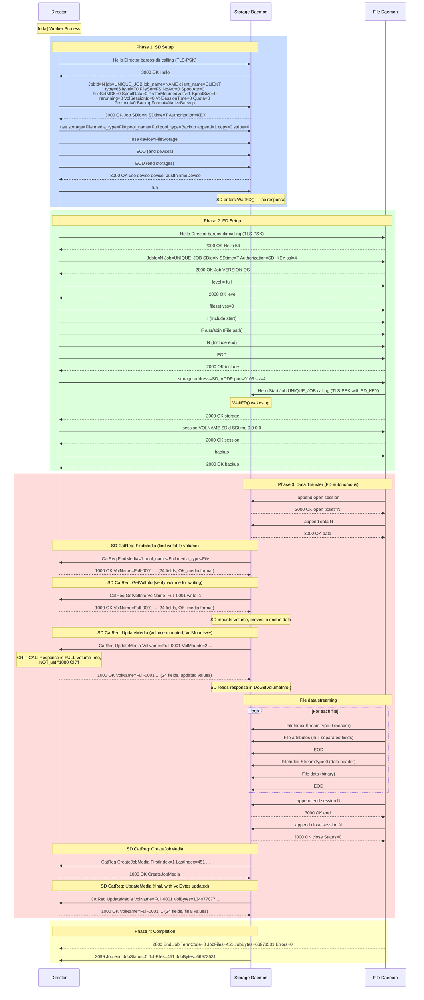
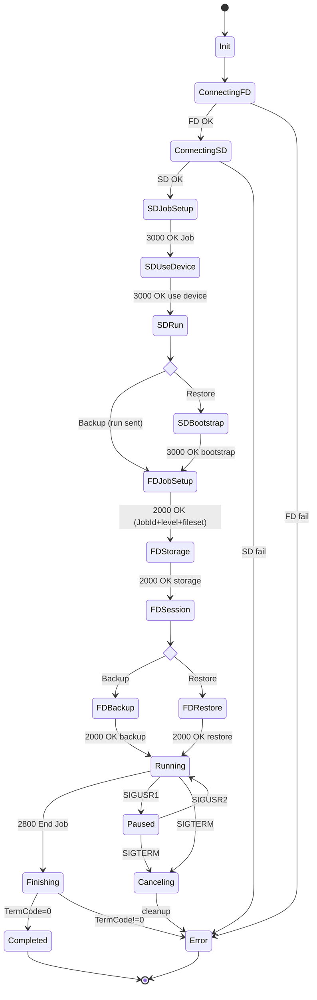
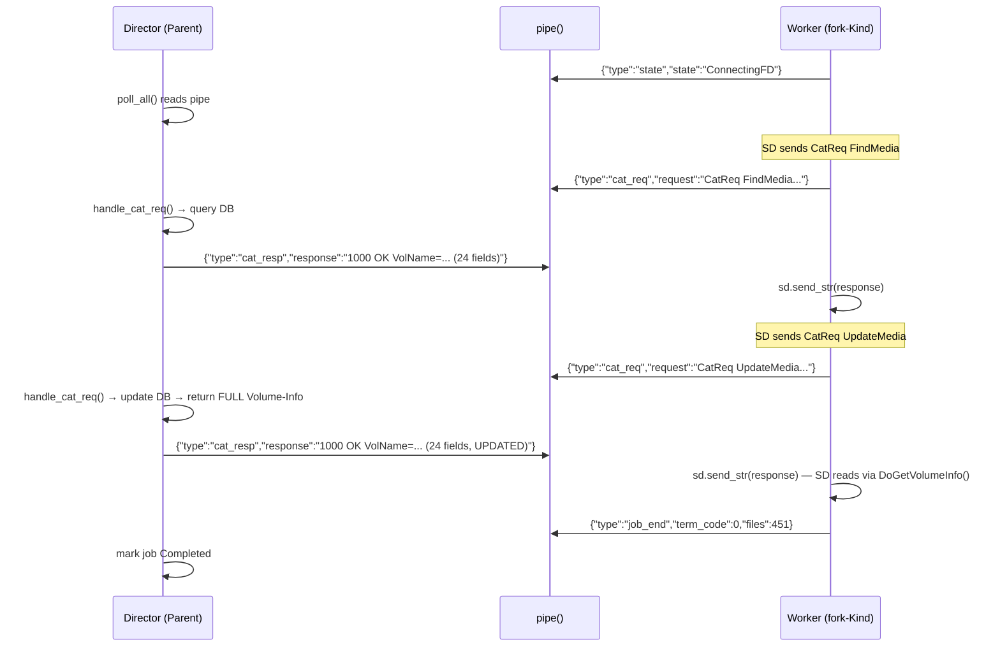

# Bareos Backup Protocol — Sequence Diagram

## Full Backup: Director → SD → FD



## CRITICAL: UpdateMedia Response Format

The SD sends `CatReq UpdateMedia ...` after mounting a volume. The Director
must respond with the **full volume info** (24 fields in `OK_media` format),
**NOT** just `"1000 OK\n"`.

The SD code (`stored/askdir.cc:364`) calls `DoGetVolumeInfo()` immediately
after sending UpdateMedia. `DoGetVolumeInfo()` does `dir->recv()` and
parses the response with `sscanf(dir->msg, OK_media, ...)` expecting
24 fields. If it gets just `"1000 OK"`, `sscanf` returns `n=0` and the
SD reports: `"Error getting Volume info: 1000 OK"`.

**Correct response** (from C++ Director `catreq.cc:93-114`, `SendVolumeInfoToStorageDaemon`):
```
1000 OK VolName=%s VolJobs=%u VolFiles=%u VolBlocks=%u VolBytes=%s
 VolMounts=%u VolErrors=%u VolWrites=%u MaxVolBytes=%s VolCapacityBytes=%s
 VolStatus=%s Slot=%d MaxVolJobs=%u MaxVolFiles=%u InChanger=%d
 VolReadTime=%s VolWriteTime=%s EndFile=%u EndBlock=%u LabelType=%d
 MediaId=%s EncryptionKey=%s MinBlocksize=%d MaxBlocksize=%d\n
```

## CatReq Types (SD → Director)

| CatReq | Director Response |
|--------|-------------------|
| `FindMedia=1 pool_name=X media_type=Y` | `OK_media` (24 fields) — find writable volume |
| `GetVolInfo VolName=X write=1` | `OK_media` (24 fields) — verify volume details |
| `UpdateMedia VolName=X VolJobs=N ...` | `OK_media` (24 fields, **updated** values!) |
| `CreateJobMedia FirstIndex=N ...` | `1000 OK CreateJobMedia\n` |
| `DeleteNullJobmediaRecords jobid=N` | `1000 OK DeleteNullJobmediaRecords\n` |
| `UpdateFileList` | `1000 OK\n` |

## Restore: Director → SD → FD (verifiziert mit d200 Traces, 2026-03-22)

```mermaid
sequenceDiagram
    participant Dir as Director
    participant SD as Storage Daemon
    participant FD as File Daemon

    Note over Dir: fork() Worker Process

    rect rgb(200,220,255)
    Note over Dir,SD: Phase 1: SD Setup (type=82/Restore, append=0)
    Dir->>SD: Hello Director bareos-dir calling (TLS-PSK)
    SD-->>Dir: 3000 OK Hello
    Note over Dir,SD: CRAM-MD5 two-way auth
    Dir->>SD: JobId=N job=UNIQUE_JOB job_name=RestoreFiles<br/>client_name=bareos-fd type=82 level=32<br/>FileSet=LinuxAll NoAttr=0 SpoolAttr=0<br/>FileSetMD5=**Dummy** SpoolData=0 PreferMountedVols=1<br/>SpoolSize=0 rerunning=0 VolSessionId=0<br/>VolSessionTime=0 Quota=0 Protocol=0<br/>BackupFormat=Native
    SD-->>Dir: 3000 OK Job SDid=N SDtime=T Authorization=KEY
    Dir->>SD: getSecureEraseCmd
    SD-->>Dir: 2000 OK SDSecureEraseCmd *None*
    Dir->>SD: use storage=File media_type=File pool_name=Incremental<br/>pool_type=Backup append=0 copy=0 stripe=0
    Dir->>SD: use device=FileStorage
    Dir->>SD: EOD (end devices)
    Dir->>SD: EOD (end storages)
    SD-->>Dir: 3000 OK use device device=FileStorage

    Note over Dir,SD: Bootstrap + run (beides!)
    Dir->>SD: bootstrap
    Dir->>SD: Storage="File"
    Dir->>SD: Volume="Full-0001"
    Dir->>SD: MediaType="File"
    Dir->>SD: Device="FileStorage"
    Dir->>SD: VolSessionId=1
    Dir->>SD: VolSessionTime=1774178747
    Dir->>SD: VolAddr=67038654-134077076
    Dir->>SD: FileIndex=1-451
    Dir->>SD: Count=451
    Dir->>SD: EOD
    SD-->>Dir: 3000 OK bootstrap
    Dir->>SD: run
    Note over SD: SD enters WaitFD()
    end

    rect rgb(220,255,220)
    Note over Dir,FD: Phase 2: FD Setup (KEIN level, KEIN fileset, KEIN session!)
    Dir->>FD: Hello Director bareos-dir calling (TLS-PSK)
    FD-->>Dir: 2000 OK Hello 54
    Note over Dir,FD: CRAM-MD5 two-way auth
    Dir->>FD: JobId=N Job=UNIQUE_JOB SDid=N SDtime=T<br/>Authorization=SD_AUTH_KEY ssl=4
    FD-->>Dir: 2000 OK Job VERSION OS
    Dir->>FD: getSecureEraseCmd
    FD-->>Dir: 2000 OK FDSecureEraseCmd *None*
    Note over Dir: KEIN level-Befehl!
    Note over Dir: KEIN fileset-Befehl!
    Dir->>FD: storage address=SD_ADDR port=9103 ssl=4<br/>Authorization=SD_AUTH_KEY
    FD->>SD: Hello Start Job UNIQUE_JOB calling<br/>(TLS-PSK mit SD_AUTH_KEY als PSK)
    Note over SD: WaitFD() wakes up
    SD->>Dir: 3010 Job UNIQUE_JOB start
    FD-->>Dir: 2000 OK storage
    Note over Dir: KEIN session-Befehl! FD macht read open selbst
    Dir->>FD: restore replace=a prelinks=0 where=/tmp/xxx
    FD-->>Dir: 2000 OK restore
    end

    rect rgb(255,220,220)
    Note over FD,SD: Phase 3: Data Transfer (SD→FD, read session)
    FD->>SD: read open session = DummyVolume SDid SDtime 0 0 0 0
    SD-->>FD: 3000 OK open ticket=N
    FD->>SD: read data N
    SD-->>FD: 3000 OK data

    Note over SD,Dir: SD CatReq: GetVolInfo (Volume fuer Lesen verifizieren)
    SD->>Dir: CatReq GetVolInfo VolName=Full-0001 write=0
    Dir-->>SD: 1000 OK VolName=Full-0001 ... (24 fields, OK_media)

    Note over SD: SD oeffnet Volume, lseek zu VolAddr Start-Position

    loop Fuer jede Datei im Bootstrap FileIndex-Range
        SD->>FD: Stream-Header: FilInx=N Stream=1 (Unix attributes) len=L
        SD->>FD: Attribut-Daten (msg format: "FileIndex Type /path")
        SD->>FD: Stream-Header: FilInx=N Stream=2 (File data) len=L
        SD->>FD: Datei-Inhalt (binaer)
        SD->>FD: Stream-Header: FilInx=N Stream=40 (XXH128 digest) len=16
        SD->>FD: Hash-Daten
    end

    Note over SD,Dir: SD CatReq: UpdateMedia (nach Volume-Release)
    SD->>Dir: CatReq UpdateMedia VolName=Full-0001<br/>VolReadTime=491072 VolMounts=4 ...
    Dir-->>SD: 1000 OK VolName=Full-0001 ... (24 fields, OK_media)

    FD->>SD: read close session N
    SD-->>FD: 3000 OK close Status = 82
    end

    rect rgb(255,255,200)
    Note over Dir,SD: Phase 4: Completion
    FD-->>Dir: 2000 OK storage end
    SD->>Dir: 3099 Job UNIQUE_JOB end JobStatus=84 JobFiles=0 JobBytes=0
    FD-->>Dir: 2800 End Job TermCode=84 JobFiles=451<br/>ReadBytes=66973531 JobBytes=66973531 Errors=0 VSS=0 Encrypt=0
    Note over Dir: TermCode=84='T'=Terminated OK
    end
```



### Key Differences: Backup vs Restore (verifiziert mit d200 Traces)

| Aspect | Backup | Restore |
|--------|--------|---------|
| SD type= | 66 ('B') | 82 ('R') |
| SD level= | 70 ('F'=Full) | 32 (' '=space) |
| SD append= | 1 (write) | 0 (read) |
| SD FileSetMD5 | echter MD5 | `**Dummy**` |
| SD BackupFormat | NativeBackup | Native |
| Nach use device | `run` (kein bootstrap) | `bootstrap` + EOD + `run` (beides!) |
| Bootstrap VolAddr | n/a | Start-End Byte-Offsets im Volume |
| FD: level cmd | `level = full` | **NICHT gesendet** |
| FD: fileset cmd | fileset + I/F/N/E + EOD | **NICHT gesendet** |
| FD: session cmd | `session VOL SDid SDtime 0 0 0 0` | **NICHT gesendet** (FD macht `read open` selbst) |
| FD: storage cmd | `storage address=X port=Y ssl=4` | `storage address=X port=Y ssl=4 Authorization=KEY` (mit Auth!) |
| FD command | `backup` | `restore replace=a prelinks=0 where=/path` |
| FD→SD session | `append open/data/end/close` | `read open/data/close` (kein `end`!) |
| SD→FD close Status | `Status=0` | `Status=82` ('R') |
| Data flow | FD → SD | SD → FD |
| CatReq | FindMedia + GetVolInfo + UpdateMedia*2 + CreateJobMedia | GetVolInfo + UpdateMedia |
| FD End Job TermCode | 0 | 84 ('T') |
| SD 3099 JobFiles | actual count | 0 (SD zaehlt bei Restore nicht) |
| getSecureEraseCmd | ja (SD + FD) | ja (SD + FD) |
| 3010 Job start | ja (nach FD→SD connect) | ja (nach FD→SD connect) |

## Worker FSM (fork()-Kind)



## Pipe Protocol (Worker ↔ Director)


